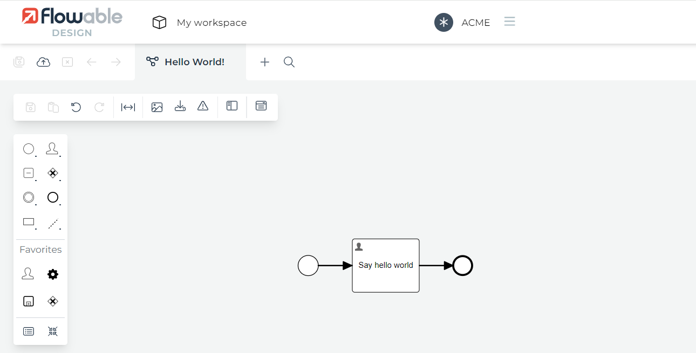

# Hello World Process Model

This document demonstrates how to create a simple Flowable process model and, more importantly, how to **test it effectively**.

## Creating the Model

The [acme application model](../../src/main/resources/apps/acme-bar.zip) was created using the Flowable Cloud Designer.

The exported `.bar` file is placed in `src/main/resources/apps/` for automatic deployment during application startup.

## The Testing Challenge

**Problem:** Most projects have little to no test coverage for their BPMN models. Typical coverage ranges from 6% to 20%. This is problematic because:

- **Modelers are not developers** – Modelers often lack the skills to write automated tests
- **No enforcement** – Teams are rarely required to write model tests, and there are no monitoring tools for model test coverage
- **Unreadable test code** – Model tests often mix Flowable API calls with assertions, making them hard to understand and maintain

## Improving Test Readability

### Before: Standard JUnit Tests

Standard JUnit tests quickly become cluttered and hard to understand:

[View original test code](https://github.com/crystal-processes/crp-flowable-springboot-sample/blob/f33a00ac53aa97136cd978326b938748cf1d3ec1/src/test/java/org/crp/flowable/springboot/sample/model/HelloWorldProcessTest.java#L61-L102)

### After: Using Fluent Assertions

Fluent assertions make tests more readable by separating API calls from verification:

[View fluent assertion test](https://github.com/crystal-processes/crp-flowable-springboot-sample/blob/f33a00ac53aa97136cd978326b938748cf1d3ec1/src/test/java/org/crp/flowable/springboot/sample/model/HelloWorldProcessTest.java#L24-L59)

### Groovy Tests

For even better readability, consider using Groovy:

[View Groovy test](https://github.com/crystal-processes/crp-flowable-springboot-sample/blob/a104ec735f37200a5eef93aab16142488c3cf82b/src/test/groovy/org/crp/flowable/springboot/sample/HelloWorldProcessGroovyTest.groovy#L19-L54)

### Spock Framework

Spock provides a specification-style testing approach that's particularly clear for BPMN scenarios:

[View Spock specification](https://github.com/crystal-processes/crp-flowable-springboot-sample/blob/98ae1cc4643b3a468cdd118ad43efbbfc742b24e/src/test/groovy/org/crp/flowable/springboot/sample/HelloWorldProcessSpec.groovy#L29-L69)

## Key Takeaways

1. **Always test your models** – BPMN models are code and should be treated as such
2. **Use the right tools** – Fluent assertions, Groovy, or Spock can significantly improve test readability
3. **Separate concerns** – Keep Flowable API calls separate from assertions
4. **Enforce coverage** – Consider adding model test coverage metrics to your CI pipeline
