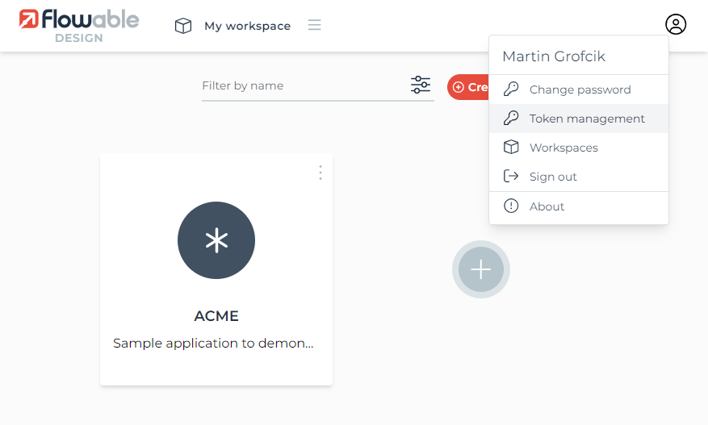
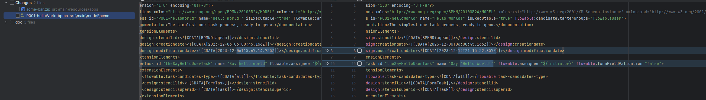

# Remote Designer Integration

Automating BPMN model downloads from a remote Flowable designer into your Maven build prevents errors and enables proper version control.

## Why Automate Model Integration

- **Eliminates manual errors** – Manual downloads are prone to mistakes
- **Enables Git tracking** – Models can be versioned alongside code
- **Supports branching & merging** – Models can follow the same workflow as your code

## Setup Instructions

### 1. Create a Flowable Account

- [Create a Flowable open-source account](https://www.flowable.com/account/open-source)
- [Login to Cloud Designer](https://cloud.flowable.com/design/)

### 2. Create or Import Your Application

Use the existing [acme application model](../../src/main/resources/apps) as a starting point, or create your own.

### 3. Generate an Access Token



### 4. Configure Your Environment

Set the `FLOWABLE_TOKEN` environment variable in your operating system:

```bash
# On Linux/macOS
export FLOWABLE_TOKEN=your-generated-token

# On Windows
set FLOWABLE_TOKEN=your-generated-token
```

For advanced configuration options with [crp-flowable-shell](https://github.com/crystal-processes/crp-flowable-ex/tree/main/crp-flowable-shell), refer to its documentation.

### 5. Configure pom.xml

Set your application name in the `pom.xml`:

[View pom.xml configuration](https://github.com/crystal-processes/crp-flowable-springboot-sample/blob/c66819a1c703d9c59c27aa12ee95d47c9c636b6a/pom.xml#L20-L24)

## Automating the Build

The `downloadModel` Maven profile uses [crp-flowable-shell](https://github.com/crystal-processes/crp-flowable-ex/tree/main/crp-flowable-shell) to automate model downloads:

```shell
./mvnw generate-resources -PdownloadModel
```

### Maven Phase Breakdown

| Maven Phase | Shell Command | Description |
|--------------|---------------|-------------|
| `generate-sources` | `designer-export ${application.name} --output-file-name target/temp_${application.name}.zip` | Exports model from designer to a temporary file |
| `process-sources` | `unzip target/temp_${application.name}.zip src/main/model/${application.name}` | Unzips model to allow local modifications |
| `generate-resources` | `zip src/main/model/${application.name} src/main/resources/apps/${application.name}-bar.zip` | Re-packages model for deployment |

## Reviewing Changes

After running the build, review model changes in your IDE:



## Additional crp-flowable-shell Commands

The tool provides useful commands for both Flowable 6.x and 7.x:

```shell
# List all available commands
java -jar ~/.m2/repository/io/github/crystal-processes/crp-flowable-shell/0.0.5/crp-flowable-shell-0.0.5.jar
```

### Deployment Commands
- `list-deployments, lsd` – List deployments
- `delete-deployments, rmd` – Delete deployments (WARNING: for testing only)
- `deploy` – Deploy an application

### Designer Commands
- `designer-export, dx` – Export application model from modeler

### Model Commands
- `import` – Import file to modeler
- `list, ls` – List models
- `delete-model, rm` – Delete model from modeler
- `export-bar` – Export deployable model from modeler
- `export` – Export model from modeler

### Other Commands
- `execute, ex` – Execute a URL
- `execute-logged, exl` – Execute URL with logged-in client
- `generate-test, gt` – Generate test from Flowable history
- `configure` – Configure Flowable REST endpoint
- `zip` – Zip directory to file
- `unzip` – Unzip file to directory
