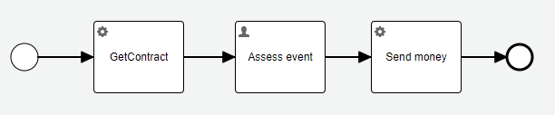
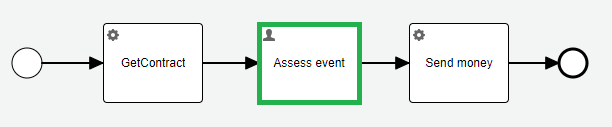

# Java Serialization Variables

This document demonstrates the problems that arise when using Java serialization for Flowable process variables.

## Use Case: Insurance Event Processing

The insurance event processing workflow from version 0.2.0:



In version 0.2.1, the `Contract` entity returned from the `getContract` service task changes. The `account` field evolves from a simple `String` to a complex `Account` structure:

```java
private final Account account; // Complex structure instead of plain String
```

This requires changes to the external service call in the `Send money` task.


## The Problem

The test for version 0.2.0, `InsuranceEventTest`, passes without issues:

[View test](https://github.com/crystal-processes/crp-flowable-springboot-sample/blob/7b9daf483b87beff3c949d9f2aa2df8e526e239e/src/test/java/org/crp/flowable/springboot/sample/insurance/InsuranceEventTest.java#L30-L47)

However, when running v0.2.0 process instances that are waiting on the `Assess event` user task:



**The process fails when trying to deserialize the `Contract` entity** in the `Send money` service task.

The upgrade test project can detect this issue:

[View upgrade test](https://github.com/crystal-processes/crp-sample-upgrade-test/blob/main/release-0.2.1/src/test/java/org/crp/flowable/springboot/sample/upgrade/ContinueInV2InsuranceEventProcessTest.java#L30)

```java
@Test
void continueInV1InsuranceEventProcessInstance() {
    ProcessInstance processInsuranceEvent = runtimeService.createProcessInstanceQuery()
            .processInstanceName("Insurance event process instance from release 0.2.0")
            .singleResult();
    Task assessEventTask = taskService.createTaskQuery()
            .processInstanceId(processInsuranceEvent.getId()).singleResult();

    assertThatThrownBy(
            () -> taskService.complete(assessEventTask.getId(), Map.of("amount", 5))
    ).isInstanceOf(FlowableException.class)
            .hasMessage("Couldn't deserialize object in variable 'contract'");
}
```

## Why This Happens

Java serialization stores the complete object graph including class metadata. When the class structure changes between versions (as with `Contract.account` evolving from `String` to `Account`), the serialized data from the old version cannot be deserialized by the new version.

## Solution Options

### Process Instance Migration

[Flowable's process instance migration](https://www.flowable.com/open-source/docs/bpmn/ch08-ProcessInstanceMigration) can help with running instances, but it has significant limitations:

- **Does not work for completed process instances** – Migration only helps processes that haven't finished
- **Complex to implement** – Requires careful planning and execution
- **Doesn't solve the root problem** – Future version changes will cause the same issue

### Better Approach: Avoid Java Serialization

The fundamental solution is to **avoid using Java serialization for process variables**. See the [Variable Best Practices](04_onlyGoodVariable.md) document for recommended alternatives.

## Key Takeaways

1. **Java serialization is fragile** – Class structure changes break deserialization
2. **Version compatibility is critical** – Consider how your variables will work across application versions
3. **Migration has limits** – It can help with running instances but doesn't solve all problems
4. **Avoid Java serialization** – Use alternative approaches like JSON, JPA, or data objects instead
