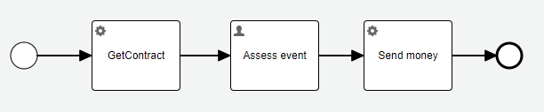

# JSON Variables

JSON serialization is a common choice for Flowable process variables. While it solves some problems with Java serialization, it introduces its own challenges, especially when the JSON structure evolves.

## Use Case: Insurance Event Processing

Using the same [insurance event use case](01_serializable.md), let's see how JSON serialization behaves when the `contract.account` field changes from a simple `String` to a complex `Account` structure.



### Version 0.2.2: Initial Structure

The initial contract structure uses a simple string for the account:

```json
{
  "account": "account-id",
  "maxAmount": 10000
}
```

The `Send money` service task in [P002-processInsuranceEvent v0.2.2](https://github.com/crystal-processes/crp-flowable-springboot-sample/blob/23b3ae07264a981fcb19b95303232c753906cd06/src/main/model/acme/P002-processInsuranceEvent.bpmn#L16) works with this structure.

### Version 0.2.3: Changed Structure

The contract structure evolves to use a nested account object:

```json
{
  "account": {
    "owner": "jlong",
    "id": "account-id"
  },
  "maxAmount": 10000
}
```

The `Send money` service task in [P002-processInsuranceEvent v0.2.3](https://github.com/crystal-processes/crp-flowable-springboot-sample/blob/945b354684623ff23e39d1803ab96dcff0a226f8/src/main/model/acme/P002-processInsuranceEvent.bpmn#L16) is updated to work with this new structure.

## The Testing Challenge

The upgrade test passes when testing version-to-version compatibility:

```shell
# Generate v0.2.2 data
./mvnw --projects release-0.2.2 clean test -Dspring.profiles.active=generateData

# Test process execution on version 0.2.3
./mvnw --projects release-0.2.3 clean test
```

[View upgrade test project](https://github.com/crystal-processes/crp-sample-upgrade-test)

Current version tests also work:

[View current version test](https://github.com/crystal-processes/crp-flowable-springboot-sample/blob/2fe6220b5d53497d5fb7ab43414da780bb532e98/src/test/java/org/crp/flowable/springboot/sample/insurance/InsuranceEventTest.java#L30-L48)

## The Real Problem

**Issue:** When the operation on the JSON structure happens **outside the process model**, you face the same problems as with Java serialization.

### Example: Creating a Report

**Task:** Create a report with the following format:

| Account | Amount Sent |
|---------|-------------|

Where "Account" should display the `account id`.

**Solution:** A `reportService` fetches all process instances from history with their variables:

[View report service](https://github.com/crystal-processes/crp-flowable-springboot-sample/blob/876dff9ca130480c6c046dd24a909832edc467c3/src/main/java/org/crp/flowable/springboot/sample/services/impl/DefaultReportService.java#L77-L78)

And maps each process instance to a JSON object. The current version only needs `contract.account.id`, but the code must support all historical contract formats:

[View report mapping logic](https://github.com/crystal-processes/crp-flowable-springboot-sample/blob/876dff9ca130480c6c046dd24a909832edc467c3/src/main/java/org/crp/flowable/springboot/sample/services/impl/DefaultReportService.java#L42-L68)

**The complexity grows** when you need to add ordering, grouping, and other report features. This becomes a maintenance burden.

### Test References

- [How to reproduce the issue](https://github.com/crystal-processes/crp-sample-upgrade-test/blob/aef07259a67166f5d0e2c052bd11217871eebaad/run_test.sh#L38-L45)
- [How to test serialization for all supported formats](https://github.com/crystal-processes/crp-sample-upgrade-test/blob/aef07259a67166f5d0e2c052bd11217871eebaad/release-0.2.4/src/test/java/org/crp/flowable/springboot/sample/upgrade/ReportTest.java#L21-L25)
- [Current version test](https://github.com/crystal-processes/crp-flowable-springboot-sample/blob/26460e9bfa316b5d90b1f1ee9992cb6668ecddad/src/test/java/org/crp/flowable/springboot/sample/services/impl/DefaultReportServiceTest.java#L39-L59)

## Key Takeaways

1. **JSON is better than Java serialization** – But it still has versioning challenges
2. **Process-internal changes are manageable** – If the structure change is handled within the process model, JSON works well
3. **External operations are problematic** – When code outside the process needs to access JSON variables, version compatibility becomes a major issue
4. **Reporting adds complexity** – Generating reports from historical process data requires handling all historical JSON structures
5. **Consider alternatives** – For complex applications, consider using JPA variables or external data storage instead

## Recommendation

Use JSON variables for simple, self-contained process data. For complex business data that needs to be accessed externally or reported on, consider the approaches described in [Variable Best Practices](04_onlyGoodVariable.md).
