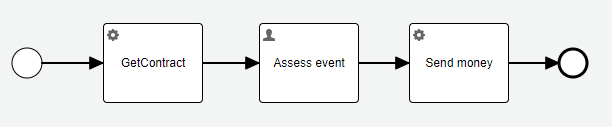

# JPA Variables

JPA (Java Persistence API) variables offer a different approach: instead of storing data directly in the process instance, Flowable stores only a reference to a JPA entity. This can simplify some scenarios but introduces new complexities.

## Use Case: Insurance Event Processing with JPA

Starting fresh with JPA, we can design a cleaner architecture. The insurance event process remains the same:



### Initial Entity Structure (v0.2.5)

```java
@Entity
@Table(name = "APP_CONTRACT")
@Builder @AllArgsConstructor @NoArgsConstructor
@Getter @Setter
public class ContractEntity {

    @Id
    @GeneratedValue(strategy = GenerationType.SEQUENCE, generator = "APP_CONTRACT_SEQ")
    @SequenceGenerator(name = "APP_CONTRACT_SEQ", allocationSize = 1)
    private Integer id;

    private String contractId;
    private String account;
    private int maxAmount;
}
```

Database schema is managed using Liquibase:

```properties
spring.liquibase.enabled=true
spring.liquibase.change-log=config/liquibase/app-change-log.xml
```

Flowable stores only a reference to the JPA entity in the process variables. The actual data is stored in the database table, which makes reporting easier.

[View JPA test](https://github.com/crystal-processes/crp-flowable-springboot-sample/blob/bd426076176f76b9130a20df462ebbafe6361f83/src/test/groovy/org/crp/flowable/springboot/sample/variables/InsuranceEventJpaTest.groovy#L47-L61)

## The Change Request

The `contract.account` field needs to change from a simple `String` to a complex `Account` structure:

[View AccountEntity](https://github.com/crystal-processes/crp-flowable-springboot-sample/blob/522003613490db5fcccaf979099805e29903ae50/src/main/java/org/crp/flowable/springboot/sample/entities/jpa/AccountEntity.java#L15-L28)

The ContractEntity is updated accordingly:

[View updated ContractEntity](https://github.com/crystal-processes/crp-flowable-springboot-sample/blob/522003613490db5fcccaf979099805e29903ae50/src/main/java/org/crp/flowable/springboot/sample/entities/jpa/ContractEntity.java#L21-L23)

This requires changes to the process model:

[View process changes](https://github.com/crystal-processes/crp-flowable-springboot-sample/blob/522003613490db5fcccaf979099805e29903ae50/src/main/model/acme/P003-jpaProcessInsuranceEvent.bpmn#L16-L17)

Database migration is handled via Liquibase changelog:

[View database migration](https://github.com/crystal-processes/crp-flowable-springboot-sample/blob/522003613490db5fcccaf979099805e29903ae50/src/main/resources/config/liquibase/app-change-log.xml#L19-L48)

## The Problem

All tests pass, including the upgrade test from version 0.2.5 to 0.2.6:

```java
@Test
void continueInV1InsuranceEventProcessInstance() {
    ProcessInstance processInsuranceEvent = runtimeService.createProcessInstanceQuery()
            .processInstanceName("Insurance event process instance from release 0.2.5")
            .singleResult();
    Task assessEventTask = taskService.createTaskQuery()
            .processInstanceId(processInsuranceEvent.getId()).singleResult();
    taskService.complete(assessEventTask.getId(), Map.of("amount", 5));

    assertThat(processInsuranceEvent).doesNotExist()
            .inHistory().isFinished()
            .hasVariableWithValue("amount", 5);
}
```

**However, the money is sent to the wrong account.**

The expectation is to send to account `1234567` the amount of `5`:

```java
Mockito.verify(moneyService, times(1)).sendMoney("1234567", 5);
```

Instead, the assertion fails with:

```
Argument(s) are different! Wanted:
moneyService bean.sendMoney("1234567", 5);

Actual invocations have different arguments:
moneyService bean.sendMoney("org.crp.flowable.springboot.sample.entities.jpa.AccountEntity@7b9c6e78", 5);
```

**The amount is sent to the `toString()` output of the AccountEntity** (`AccountEntity@7b9c6e78`) instead of the actual account number `1234567`.

[View complete test](https://github.com/crystal-processes/crp-sample-upgrade-test/blob/006d9334f4da618a949e9fefb98bc1b10b047c00/release-0.2.6/src/test/java/org/crp/flowable/springboot/sample/upgrade/ContinueInJpaInsuranceEventProcessTest.java#L36)

## Why This Happens

When Flowable stores a JPA entity as a process variable, it stores only a reference (typically the entity's ID). When the process variable is retrieved, Flowable fetches the current version of the entity from the database.

**The problem:** The process model expression `${contract.account}` returns the AccountEntity object itself, not its ID. When this is passed to the service task, it uses the object's `toString()` method, which produces the useless default representation.

## The Solution

The only reliable way to access data across different model versions is to **use services** to fetch the data. The service layer abstracts away the entity structure and provides a stable interface.

This is exactly what the [Variable Best Practices](04_onlyGoodVariable.md) recommend: always access application data through services, not directly through process variables.

## Key Takeaways

1. **JPA variables store references** – Only the entity ID is stored in the process, the actual data lives in the database
2. **Database migration is easier** – Changing entity structure is handled by Liquibase or your preferred migration tool
3. **Reporting is simpler** – Data is already in the database, making reporting straightforward
4. **But be careful with object references** – Directly using entity objects in expressions can lead to unexpected behavior
5. **Use services for access** – Always retrieve data through service methods to maintain control and version compatibility
6. **This still has the versioning problem** – While better than serialization, JPA variables still require careful management across versions
