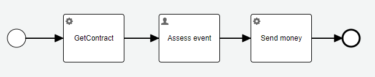
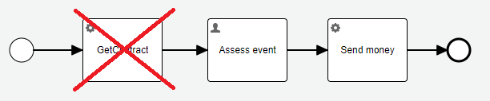
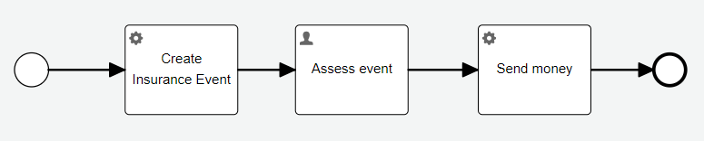

# Variable Best Practices

This document presents practical rules for working with Flowable process variables. Following these guidelines will prevent common maintenance issues, versioning problems, and technical debt.

## The Four Rules

### 1. The Only Good Variable is a Non-Existing Variable

**Think twice before creating any process variable.**

Every variable adds complexity to your process and maintenance burden to your application. Ask yourself:
- Does this data need to be stored in the process instance?
- Can this data be retrieved when needed instead of stored?
- Will this variable cause problems when the process model or application evolves?

### 2. Use Transient Variables When Possible

**If you must have a variable, make it transient.**

Transient variables exist only for the duration of a single process instance execution and are not persisted. They are ideal for temporary data that doesn't need to survive process restarts or be accessible from history.

### 3. Store Application Data Outside the Process

**Do not store application data in process/case instances.**

Use these alternatives instead:
- **Data Objects** – Store structured data separate from the process
- **JPA Entities** – Store data in your database with proper relationships
- **External Services** – Fetch data from external systems when needed

The process should only store references (IDs) to application data, not the data itself.

### 4. Access Data Through Services

**Always use services to fetch application data.**

This is the most important rule. When accessing data:
- Use a service layer that abstracts the data source
- Keep versioning under application control, not Flowable control
- Ask: "Is versioning managed by Flowable or by the application?"

## Applying the Rules: Practical Example

Let's apply these rules to the insurance event process:



### Initial State

The process has these inputs and variables:
- `contractId`, `requestedAmount`, `eventDescription` – Process instance inputs
- `contract` – Instantiated after `GetContract` task
- `amount` – Created after `Assess event` task

The process operates on application data: the `Insurance Event` entity with attributes:
- `contract` (referenced by `contractId`)
- `requestedAmount`
- `eventDescription`
- `amount` (filled after the `Assess event` user task)

### Problem: Direct Variable Access

If the process stores the `Contract` as a JPA variable, it stores only a reference. 

**Warning:** Do not access `Insurance Event` values directly. Always use services.

[View JPA variables use case](03_jpaVariables.md)

### First Refactoring: Remove GetContract Task

The `GetContract` service task before the `Assess event` user task can be **completely removed**.

**Why?** The data is fetched only to be presented on the form. This creates:
- Redundant process variables
- Vulnerability to changes in external structures
- Synchronization requirements

**Solution:** The form should receive data directly from a service that provides contract data by `contractId` (e.g., a REST API call).

This applies **Rules 1 and 3**: Avoid unnecessary variables and store application data outside the process.



### Second Refactoring: Remove Amount Variable

The `amount` variable can also be removed.

**Why?** While it's easy to store `amount` in the process instance (Flowable encourages this), it has the same problems as `contract`:
- The `amount` might need to be extended (e.g., adding currency)
- It creates the same versioning and synchronization issues

**Solution:** Apply **Rule 2** – make the variable transient. But transient variables are not necessary if `amount` as application data is stored outside the process instance.

### Final Architecture

Starting fresh with all rules applied:



**Key changes:**
1. The contract reference and all inputs related to the event instance are stored in the insurance event entity
2. The `Send money` service task uses an expression like:

```
${insuranceEventService.sendMoney(insuranceEventId, amount)}
```

[View service implementation](https://github.com/crystal-processes/crp-flowable-springboot-sample/blob/fcc88c803e84d11530878be8e940ddc61f162ed4/src/main/model/acme/P003-jpaProcessInsuranceEvent.bpmn#L16-L16)

[View updated service call](https://github.com/crystal-processes/crp-flowable-springboot-sample/blob/a2f8422a02445a4cdabcba4c1d913d11c1d725fd/src/main/model/acme/P004-jpaServicesProcessInsuranceEvent.bpmn#L22-L22)

The service call is now **independent of data format changes**. This is the power of **Rule 4** – accessing data through services.

## Complete Test Example

The complete Groovy test demonstrates this approach:

[View Groovy test](https://github.com/crystal-processes/crp-flowable-springboot-sample/blob/5fec9763027479a6482d887be74481b28463309a/src/test/groovy/org/crp/flowable/springboot/sample/variables/InsuranceEventJpaServicesTest.groovy#L63-L83)

## Summary

Following these four rules will dramatically improve your Flowable applications:

1. **Avoid variables** – Only create variables when absolutely necessary
2. **Use transient variables** – When you need a variable, make it transient
3. **Store data externally** – Keep application data in data objects, JPA entities, or external systems
4. **Access through services** – Always use a service layer to fetch and manipulate data

These patterns prevent common issues with:
- Data consistency across process versions
- Versioning conflicts
- Maintenance complexity
- Technical debt accumulation

**Remember:** The fewer variables you have, the simpler and more maintainable your process applications will be.
